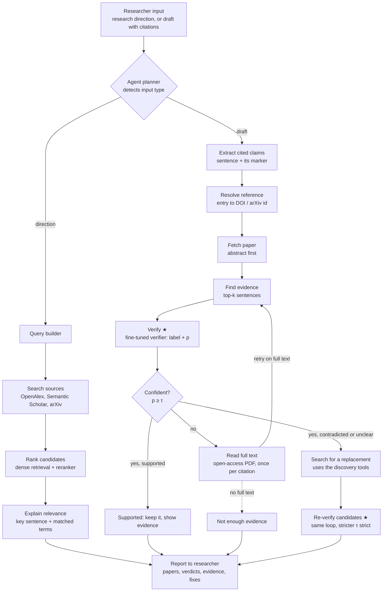
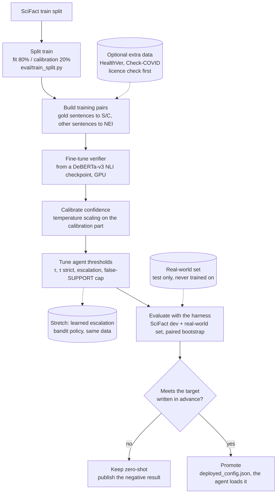

# CiteCheck as an agent: plan after the midterm

Owner: Product.  **Status: proposed in the Session 7 PR. It is approved when that PR merges with an approving
review, and every member has said yes on the PR.**  Interactive version of the diagrams: the "CiteCheck Agent Blueprint"
page shared in the team chat (same content).

## Why we are changing direction

At the midterm (Oct 6) our decision was *persevere (provisional)*: the zero-shot verifier beat both baselines on SciFact
dev, but no outside user had used the product (`docs/midterm_numbers.md`). Seeing the other teams, we also concluded the
product was too narrow: one hand-typed claim, one paper, an off-the-shelf model, abstracts only.

Two facts from our own evaluation shape the new plan:

1. **The verifier is the bottleneck.** Given the gold paper and the gold sentences, the zero-shot verifier reaches only
   0.646 macro-F1, against 0.603 end to end (`eval/results/zero_shot_nli/results.json`). Better retrieval did not help
   (hybrid: 0.587). So we train our own verifier.
2. **A researcher's job is bigger than one claim.** They want to find papers for a research direction, and to check every
   citation in what they write. So the product becomes an agent that does both.

## The product in one sentence

> **CiteCheck helps researchers find papers for their research direction and check every citation in their draft,
> showing the sentences that decide each verdict and saying so when it is unsure.**

## Part 1: what the agent does at run time

★ = runs the fine-tuned verifier from Part 2.

The agent makes four decisions on its own. Each one has a rule we can test and a number we report:

| Decision | Rule at launch | Tuned on | Measured by |
|---|---|---|---|
| Read the full text? | p < τ and an open-access full text exists; at most once per citation | calibration part of train | how many "unsure" answers become correct verdicts; extra seconds per citation |
| Trust the verdict? | p ≥ τ, otherwise Not enough evidence | calibration part | macro-F1, false-SUPPORT rate, coverage |
| Look for a replacement? | verdict is Contradicts or Not enough evidence | fixed rule | how often the original citation was flagged correctly |
| Suggest a candidate? | Supports with p ≥ τ strict, no contradicting sentence, not the paper that failed, published before the draft | calibration part | bad-replacement rate (SciFact swap test + a hand-checked sample) |

Replacement suggestions are **suggestions to read, never automatic swaps**, and the evidence sentences are always shown.
An agent that keeps searching until something agrees would encourage citing papers unread; the stricter threshold and the
visible evidence are the safeguards, and this goes into our ethics section.

## Part 2: how the verifier is fine-tuned and promoted

Rules: dev and test are never used to fit or tune anything. The calibration part is never trained on: if τ were tuned on
the claims the model was fitted on, the model would look more confident than it is and the agent would escalate too rarely.
The model we report is the model in the demo (`eval/results/deployed_config.json`), as before.

## Experiments, with targets set before running

Targets are in `docs/north_star.md` ("Session 7 targets"), written before any of these runs exist.

| Experiment | Compared against | Data |
|---|---|---|
| E1 fine-tuned verifier | deployed zero-shot NLI (dev macro-F1 0.603, false-SUPPORT 0.108) | SciFact dev |
| E2 agent with full-text escalation | same model, abstracts only | real-world set (SciFact cannot show this: its evidence is always in the abstract) |
| E3 replacement suggestions | no suggestion | SciFact swap test |
| E4 real-world gap | SciFact dev score | real-world set, two labellers, Cohen's kappa |
| E5 learned escalation (stretch) | fixed τ rule | calibration part, then real-world set |

## Scope decisions

- **Text-based PDFs only.** We do not run OCR. A scanned PDF is refused at upload with a message offering to paste the
  text instead (`src/pdf_check.py`). Mixed files are accepted and the unreadable pages are listed. Every refusal is logged
  (anonymised), so we learn whether OCR is worth adding later.
- **"Any paper" means any paper's metadata and abstract.** Full text is read only when a legal open-access copy exists
  (Unpaywall, Europe PMC, arXiv). For paywalled papers the agent says it only read the abstract.
- **Free resources only.** No paid APIs and no hosted LLM inside the product. If we use a small local LLM at all, it is only
  for turning a research direction into search queries, never for the verdict.
- **Fields.** We evaluate on biomedicine (SciFact) and one more field for the real-world set; computer science from arXiv is
  the easiest because its full text is free.
- **Stretch only after everything above works:** learned escalation (E5), the discovery path's own relevance model.

## What the agent uses (all free)

| Need | What we use |
|---|---|
| Papers to search | OpenAlex (free key, daily budget), Semantic Scholar (free key), arXiv, PubMed |
| References to DOIs | Crossref (polite pool with a contact e-mail), OpenAlex lookups |
| Full text | Unpaywall (finds the legal open copy), Europe PMC, arXiv, CORE |
| Reading PDFs | GROBID (sections, sentences, reference list), pypdf for the text check |
| Deciding | rules + thresholds tuned on the calibration part (stretch: a learned bandit policy) |
| Judging | our fine-tuned verifier, sentence embeddings (e.g. SPECTER2), a small cross-encoder reranker, BM25 |
| Remembering | SQLite cache of every response, FAISS index, a run log of every decision and why |
| Compute | a laptop GPU for fine-tuning (base model), free Colab as backup, CPU for running the agent |

Free tiers have limits, so every source goes behind one tool interface with a cache and a fallback.
`python -m tools.live_sources_check` records which sources answered on a given day (`docs/live_checks/`).

## Owners (by hat)

| Hat | Boxes and work |
|---|---|
| Engineering | planner and loop, extract cited claims, resolve reference, fetch paper and full text, discovery path, report export, PDF check, app, deployment |
| Operations (modeling) | training pairs, fine-tuning, calibration, threshold tuning; stretch E5 |
| Data & Evaluation | find evidence, data splits, evaluation harness (including the agent's), every reported number |
| Product | what discovery and the report must show, targets (with Data & Evaluation), pitch and lean canvas |
| Users & Research | real users on each new piece every week, the real-world set and its labelling guide, raw evidence committed the same week |

File ownership between modeling and evaluation: modeling owns the training code and model choices (`eval/finetune_nli.py`
and the calibration code); Data & Evaluation owns the splits, the harnesses (`eval/run_eval.py`, `eval/metrics.py`,
`eval/agent_eval.py`) and the final numbers. The person who trains a model is never the one who scores it.

## Build order

| Session | What reaches `main` |
|---|---|
| 7, Oct 20 | this plan and the targets; **agent v1**: claim extraction, reference resolution, paper fetch, full-text escalation, replacement search, discovery path, report download, app tabs, Docker image for Hugging Face Spaces; E3 swap-test harness; real-world set tooling and labelling guide; fit/calibration split; live source check; PDF text check. Agent-level behaviour not yet evaluated |
| 8, Oct 27 | first E3 run on SciFact dev; deployed app in front of outside users; real-world set candidates collected; first fine-tuning runs (modeling) |
| 9, Nov 3 | calibrated fine-tuned model (E1); real-world set v1 double-labelled with kappa; tau strict tuned on the calibration part |
| 10, Nov 10 | E2 on the real-world set; promotion decision for the fine-tuned verifier |
| 11, Nov 17 | fixes from error analysis; feature freeze |
| 12, Nov 24 | deployed for strangers; error analysis; ethics section; E5 only if everything else is done |
| 13, Dec 1 | final submission: the model we report is the model in the demo |

Every week still runs the course loop: ship, put it in front of a real user, commit the raw evidence that week, measure,
report honestly.
